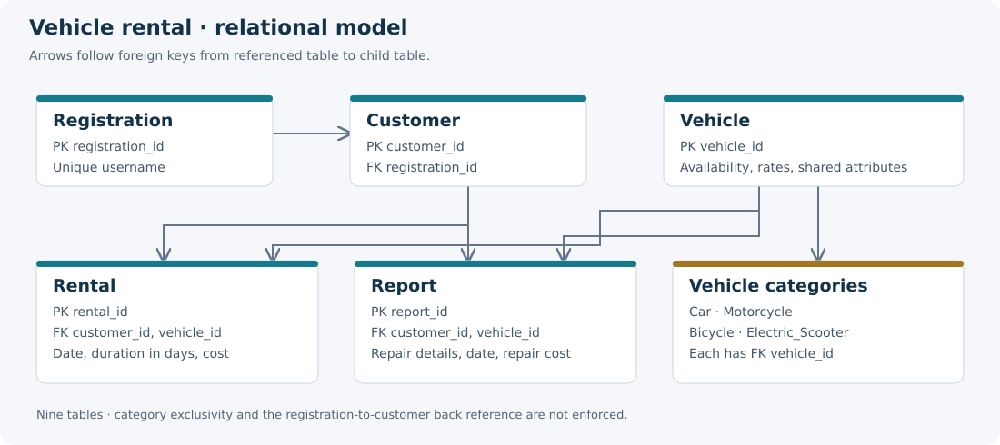

# Vehicle Rental Database

A relational database project for a vehicle-rental service, built for the University of Crete HY360 databases course. It connects ER modeling and SQL reporting with Java/JDBC table helpers and a small servlet-based web interface.

**Java · MySQL · JDBC · Servlets · Gson · Maven**

[Technical brief report](docs/portfolio-report.pdf) · [Original course report (Greek)](docs/report.pdf) · [Setup and implementation notes](docs/SETUP.md)



## What the project covers

- Nine tables for registrations, customers, vehicles, four vehicle categories, rentals, and repair reports.
- Primary keys, unique fields, and foreign keys connecting customers, vehicles, and rental history.
- JDBC table creation and data access, including availability filters and conversion of query results to JSON.
- SQL joins and aggregates for inventory, period rentals, rental duration, revenue, and repair expenditure.

The original report contains the ER diagram, relational model, and query screenshots. The Java classes and [SQL schema](sql/schema.sql) show the implemented model.

## Run the database checks

Requires **JDK 17 and Maven 3.9+**:

```sh
mvn verify
```

This builds `target/database.war` and runs seven integration tests against an isolated H2 database in MySQL compatibility mode. Tests exercise the Java table builders, exported schema, foreign-key and uniqueness constraints, availability helpers, and five reporting queries using [synthetic data](sql/demo-data.sql). No database server is needed for these checks.

For a MySQL database and Tomcat 9 deployment, see [setup](docs/SETUP.md). H2 checks do not establish MySQL deployment or complete browser workflows. The web interface is a course prototype with unfinished registration, session restoration, and motorcycle/accident actions. The setup guide records these limits.

## Explore

| Artifact | Contents |
| --- | --- |
| [`src/main/java/database`](src/main/java/database) | JDBC connection, initialization, table helpers |
| [`src/main/java/mainClasses`](src/main/java/mainClasses) | Domain objects and JSON conversion |
| [`src/main/java/servlets`](src/main/java/servlets) | HTTP endpoints |
| [`sql`](sql) | Schema, synthetic fixtures, five reporting queries |
| [`src/test`](src/test) | Reproducible database checks |
| [LaTeX sources](docs/portfolio-report/main.tex) · [Overleaf ZIP](docs/portfolio-report-overleaf.zip) | Editable companion report |

## Team

Developed by **Dimitris Asimakopoulos, Alexandros Fourtounis, and Georgia (Marina) Tsanta** as an undergraduate course project.
